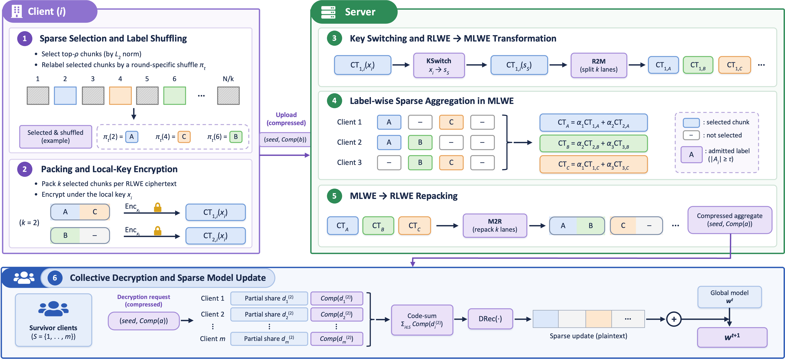
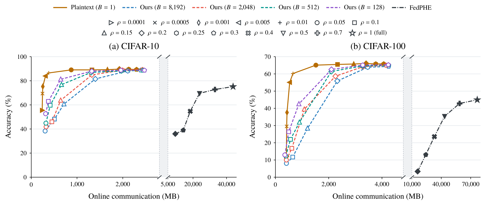
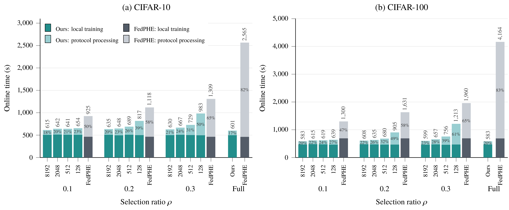

# Communication-Efficient Threshold-CKKS Aggregation for Secure Cross-Silo Federated Learning

**Jihyung Kook\*, Dokyeong Kang\*, and Eunsang Lee**  
Department of Software, Sejong University  
\*Equal contribution. Corresponding author: Eunsang Lee.

## Overview

In cross-silo federated learning, participating organizations train a shared model while keeping their training data local. This work addresses the communication cost of aggregating their encrypted model updates. Each client encrypts under an independent local key. The server applies weights fixed at setup, and the clients jointly decrypt the aggregate. The protocol requires no trusted key-distribution center.

<p align="center">
  <a href="figures/protocol.png">
    
  </a>
</p>
<p align="center"><em>Figure 1. Overview of the proposed threshold-CKKS aggregation protocol.</em></p>

**Full** packs dense model updates into ring learning with errors (RLWE) ciphertexts and aggregates them directly. **Sparse** lets each client select which chunks of its update to send. Drawing on the ciphertext conversion techniques in [HERMES][hermes], the server converts packed RLWE ciphertexts into module learning with errors (MLWE) ciphertexts. This lets the server align and aggregate encrypted chunks from the same model position even when clients select different sets of chunks. The server then repacks the aggregated chunks into RLWE ciphertexts for collective decryption. This allows the chunk size to be chosen independently of the RLWE packing dimension.

The paper analyzes fixed-cohort executions without dropout or retry against a semi-honest server colluding with up to $c$ clients, under the stated leakage model and a minimum cohort size of $\tau \geq c+2$. A separate experiment evaluates a client dropping out after uploading its update and before the first decryption request.

## Repository structure

| Directory | Role |
| --- | --- |
| [plaintext-FL-python/](plaintext-FL-python/) | PyTorch training code, plaintext baselines, encrypted training commands, and experiment profiles. |
| [ciphertext-FL-cpp/](ciphertext-FL-cpp/) | OpenFHE-based C++ engine for encrypted aggregation and collective decryption, including the Python binding used during training. |
| [figures/](figures/) | Protocol overview, accuracy versus communication, and online runtime breakdown. |

## Getting started

### Plaintext training

From the repository root, install the Python package in an activated environment with Python 3.10 or later. The two help commands list the options for the Full and Sparse baselines.

```bash
cd plaintext-FL-python
python -m pip install -e .
federated-full --help
python -m plaintext_fl.federated_sparse --help
```

### Encrypted training

Build the C++ engine and Python binding by following the [installation instructions](plaintext-FL-python/README.md#installation). Run the installation commands from the Python directory in this checkout so that `../ciphertext-FL-cpp` resolves to the sibling C++ directory.

Choose a [dataset and profile](plaintext-FL-python/README.md#supported-profiles), then follow the [CIFAR training example](plaintext-FL-python/README.md#cifar-10-example). The Full and Sparse entry points are `encrypted-full` and `encrypted-sparse`. Each requires the corresponding profile. The [C++ README](ciphertext-FL-cpp/README.md#tests) also provides a native functional test.

## Experimental Results

The paper evaluates CIFAR-10 with ResNet-20 and CIFAR-100 with ResNet-32. Unless otherwise specified, training uses eight clients, 200 communication rounds, and a non-IID Dirichlet partition with $\alpha=1.0$.

### Accuracy and communication

<p align="center">
  <a href="figures/accuracy-communication.png">
    
  </a>
</p>
<p align="center"><em>Figure 2. Best accuracy versus cumulative online communication on CIFAR-10 and CIFAR-100. Shaded bands mark axis breaks.</em></p>

Online traffic sums all client uploads and server-to-client unicasts over 200 rounds. Setup traffic is reported separately. The comparisons below use seed 42 and Sparse with chunk size $B=128$. For each target accuracy, we linearly interpolate online traffic between the two adjacent measured configurations that bracket the target.

**Comparison with FedPHE.** For each dataset, we use the best accuracy of full-transmission [FedPHE][fedphe] as the target and compare the online traffic required by each method at that accuracy.

| Dataset | Target accuracy | FedPHE (MB) | Sparse (MB) | FedPHE / Sparse |
| --- | ---: | ---: | ---: | ---: |
| CIFAR-10 | 75.19% | 43,909.13 | 554.46 | 79.2× |
| CIFAR-100 | 44.96% | 76,677.13 | 915.00 | 83.8× |

**Comparison with plaintext FL.** The target is five percentage points below the best accuracy of full-transmission plaintext FL on each dataset.

| Dataset | Target accuracy | Plaintext FL (MB) | Sparse (MB) | Sparse / Plaintext |
| --- | ---: | ---: | ---: | ---: |
| CIFAR-10 | 84.92% | 337.45 | 847.72 | 2.5× |
| CIFAR-100 | 61.32% | 852.63 | 1,755.32 | 2.1× |

### Online runtime

<p align="center">
  <a href="figures/time.png">
    
  </a>
</p>
<p align="center"><em>Figure 3. Online runtime by transmission ratio and chunk size, broken down into local training and protocol processing.</em></p>

At $\rho=0.2$ and $B=128$, protocol processing accounts for **38.8%** of online runtime on CIFAR-10 and **48.6%** on CIFAR-100. We calculate online runtime from measured local training and protocol-processing times under a parallel-client execution model. It excludes setup, model evaluation, and network latency.

Tables III and IV in the paper report the effects of temporary client dropout and client count on CIFAR-100. Supplementary Section S7 gives the per-configuration results.

## Citation

Jihyung Kook, Dokyeong Kang, and Eunsang Lee. “Communication-Efficient Threshold-CKKS Aggregation for Secure Cross-Silo Federated Learning.”

## References

- Y. Bae, J. H. Cheon, J. Kim, J. H. Park, and D. Stehlé, “[HERMES: Efficient Ring Packing Using MLWE Ciphertexts and Application to Transciphering][hermes],” in *Advances in Cryptology – CRYPTO 2023*, Lecture Notes in Computer Science, vol. 14084, Springer, 2023, pp. 37–69.

- Y. Li, N. Yan, J. Chen, X. Wang, J. Hong, K. He, W. Wang, and B. Li, “[FedPHE: A Secure and Efficient Federated Learning via Packed Homomorphic Encryption][fedphe],” *IEEE Transactions on Dependable and Secure Computing*, vol. 22, no. 5, pp. 5448–5463, 2025.

[hermes]: https://eprint.iacr.org/2023/1244
[fedphe]: https://doi.org/10.1109/TDSC.2025.3567301